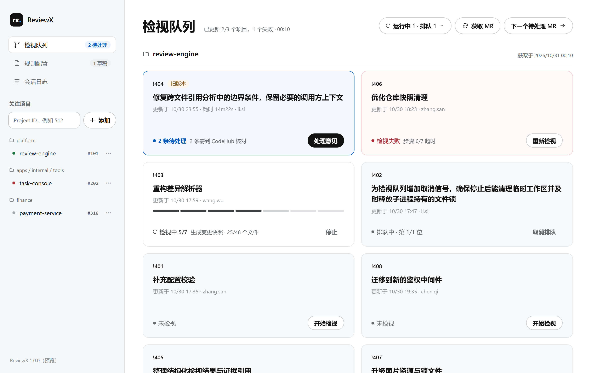
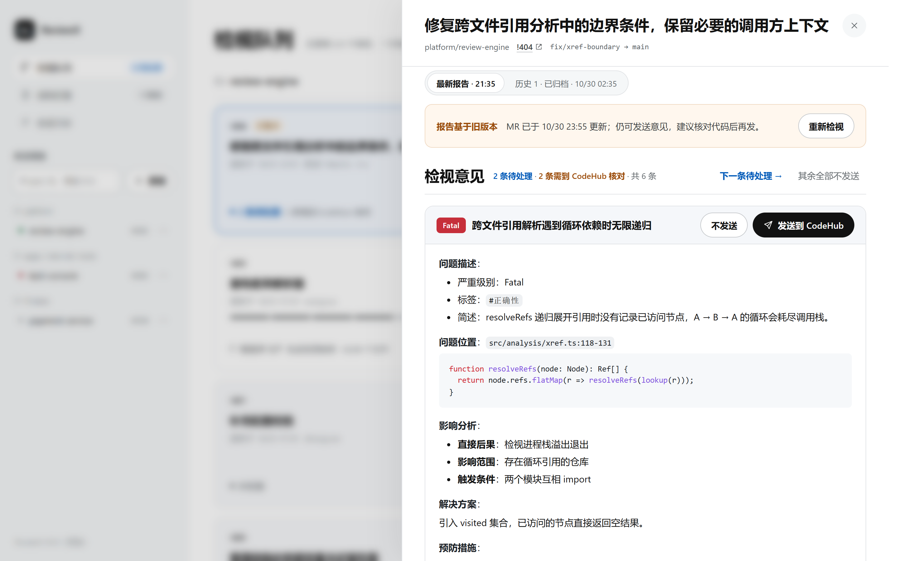
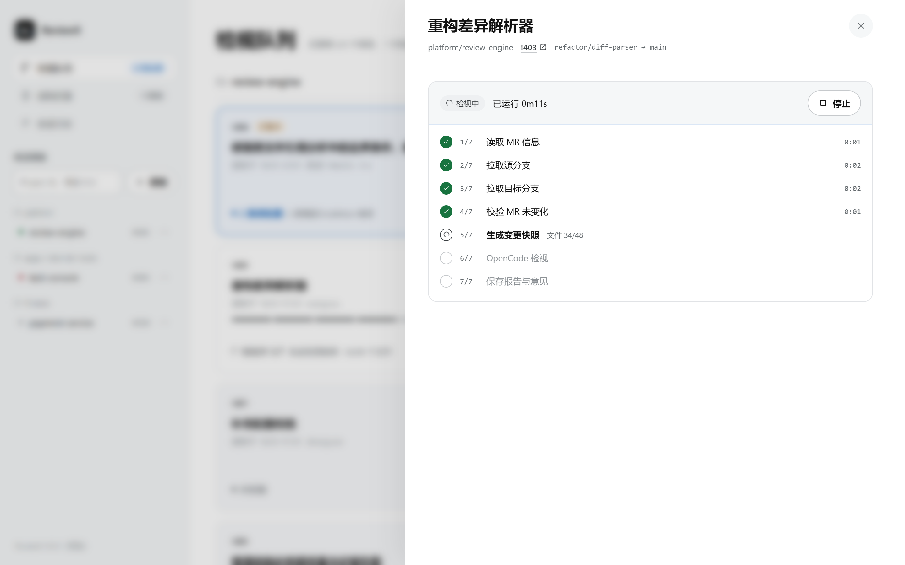
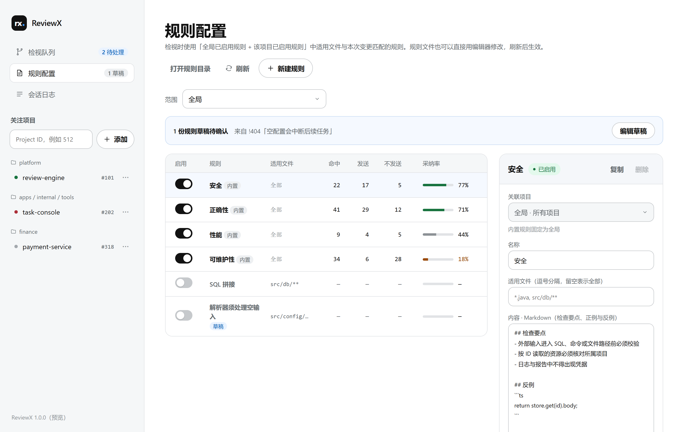
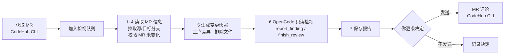

<div align="center">

<picture>
  <source media="(prefers-color-scheme: dark)" srcset="docs/assets/readme/banner-dark.png">
  
</picture>

<p>
  <a href="LICENSE"></a>
  
  
  
  
</p>

<p>
  <a href="#快速开始">快速开始</a> ·
  <a href="#功能">功能</a> ·
  <a href="#工作原理">工作原理</a> ·
  <a href="#隐私与安全">隐私与安全</a> ·
  <a href="#配置">配置</a> ·
  <a href="#常见问题">常见问题</a> ·
  <a href="#参与开发">参与开发</a>
</p>

</div>

**ReviewX** 是一款运行在你自己电脑上的 CodeHub 代码检视助手。它拉取你关注的项目里的开放 MR，用 [OpenCode](https://opencode.ai) 在只读环境中逐个检视代码变更，把发现的问题整理成结构化意见；每一条意见是否发到 CodeHub，都由你逐条决定。

- **AI 只建议，你来决定**：意见不会自动发布。你逐条选择「发送到 CodeHub」或「不发送」，发布结果如实显示为已发布、发布失败或结果未知。
- **只读、可控的 AI**：OpenCode 只能读取本次变更的代码，不能修改文件、执行命令或联网；出现白名单以外的工具调用会立即终止会话。
- **结果可信**：失败或中断的检视不会冒充完成；报告和处理记录只追加、不覆盖，重启后仍可追溯。
- **本机运行，凭据不经手**：只监听 127.0.0.1，不设账号；CodeHub 和 Git 凭据由各自的工具保管，ReviewX 不接收、不保存，也不交给 AI。

## 功能

### 检视队列



把关注项目的开放 MR 放在一个工作台里，哪些还有待处理的意见一眼可见。

- **手动获取 MR**：点「获取 MR」并行拉取所有关注项目，单个项目失败不影响其余项目，失败的项目保留上次结果并可单独重新获取。
- **串行检视队列**：选中 MR 开始检视，全局同一时间只运行一个；可以取消排队、随时停止，主动停止不算失败。
- **状态一目了然**：每张卡片显示「N 条待处理」「N 条需到 CodeHub 核对」「已处理完」「检视失败」等状态；MR 在报告之后有新提交时标出「旧版本」。
- **下一个待处理 MR**：一键跳到还有待处理意见的 MR，处理完一个接着下一个。

### 检视报告



每条意见都按 MR 评论模板组织：**问题描述**（严重级别、标签、简述）、**问题位置**、相关代码、**影响分析**（直接后果、影响范围、触发条件）、**解决方案**和**预防措施**。

- **逐条决定**：「发送到 CodeHub」只发这一条；「不发送」可以撤销；还可以「其余全部不发送」，确认后执行。
- **发布结果如实反馈**：结果未知时提示你到 CodeHub 核对，并标记「已在 CodeHub 看到」或「确认未发布」；发布失败可手动重新发送。ReviewX 从不自动重试，避免重复评论。
- **三种明确结论**：发现问题、未发现问题、无可检视的变更（例如只改了锁文件和图片），三者互不混用。
- **历次报告**：重新检视会生成新报告，旧报告归档为只读，可以在顶部切换查看。

### 实时进度



每次检视按 7 个步骤执行，页面实时显示当前步骤和步骤内进度（如「文件 34/48」「差异 8/12 · 意见 3 条」），已完成步骤显示耗时，无需刷新。失败时会说明原因、失败在哪一步、哪些步骤已完成，以及接下来该做什么。

### 检视规则



用 Markdown 写下团队关心的检视要点，让 AI 重点检查。

- **全局与项目级**：检视时使用「全局已启用规则 + 该项目已启用规则」中适用文件与本次变更匹配的规则。
- **效果可见**：每条规则显示近 30 天的命中、发送、不发送次数和采纳率，帮你判断哪些规则有用、哪些需要调整。
- **持续沉淀**：已发送的意见可以一键「沉淀为规则草稿」，编辑确认后启用。
- **文件即规则**：规则保存在数据目录的 Markdown 文件中，也可以用编辑器或 Git 管理，修改后无需重启。内置正确性、安全、性能、可维护性四条通用规则作为起点。

此外：会话日志页面查看本次启动以来的诊断日志（已去除凭据），关注项目可移除并在重新添加后恢复历史，关闭 ReviewX 后再打开，报告和处理记录都还在。

## 快速开始

### 先试一试：预览模式

不想先配环境？安装并启动 ReviewX 后，访问 **`http://127.0.0.1:17080/preview`**。预览模式用示例数据在浏览器里模拟全部后台行为，你可以获取 MR、看检视进度推进、发送和处理意见、编辑规则。它不会连接 CodeHub、Git 或 OpenCode，也不会写入任何本机文件；刷新页面或点「重置示例数据」即恢复初始状态。

### 环境要求

| 依赖 | 要求 |
| --- | --- |
| 操作系统 | Windows 10 或 11 |
| [Node.js](https://nodejs.org) | 22 或更高版本 |
| [CodeHub CLI](https://github.com/BlackLotusAL/CodeHubX) | 已安装并登录（`codehub auth login`），终端里能运行 `codehub` |
| [Git](https://git-scm.com) | 已配置好访问代码仓库的凭据（凭据管理器或 SSH 密钥） |
| [OpenCode](https://opencode.ai) | 已安装并配置默认模型，终端里能运行 `opencode` |

### 安装

```bash
git clone https://github.com/BlackLotusAL/ReviewX.git
```

```bash
cd ReviewX
```

```bash
npm install -g .
```

ReviewX 没有第三方运行时依赖，安装只是把 `reviewx` 命令注册到系统中。

### 启动

```bash
reviewx
```

终端会打印访问地址、配置文件位置和当天的诊断日志路径，并用默认浏览器打开页面（浏览器打不开时，按打印的地址手动访问）。关闭浏览器不影响服务和正在进行的检视；在终端按 **Ctrl+C** 停止服务，ReviewX 会结束自己启动的全部子进程并清理临时目录。

| 参数 | 作用 |
| --- | --- |
| `--config <路径>` | 使用指定的配置文件 |
| `--no-open` | 启动后不自动打开浏览器 |
| `--version` | 显示版本号 |

### 首次使用

1. 在左侧输入框填入 CodeHub 项目的 **Project ID**，点「添加」。ReviewX 会通过 CodeHub CLI 确认项目存在且可访问。
2. 点「**获取 MR**」，列出关注项目中的开放 MR。
3. 在 MR 卡片上点「**开始检视**」，检视进入队列；点卡片标题可以查看实时进度。
4. 检视完成后点「**处理意见**」，逐条阅读，选择「发送到 CodeHub」或「不发送」。
5. 需要团队自己的检视要点时，到「**规则配置**」新建规则。

## 工作原理



| 步骤 | 做什么 |
| --- | --- |
| 1 读取 MR 信息 | 通过 `codehub mr view` 读取标题、分支和更新时间 |
| 2–3 拉取源分支 / 目标分支 | 每个项目在本机保留一份部分克隆的代码缓存，只拉取这两个分支并固定到当时的提交 |
| 4 校验 MR 未变化 | 再次读取 MR 更新时间，拉取期间 MR 有变化则本次检视失败，避免基于不一致的代码 |
| 5 生成变更快照 | 按目标分支与源分支的分叉点比较（与 CodeHub MR 页面一致），排除锁文件、图片、二进制等，导出只读的检视副本并把每个文件的差异写入 `.reviewx-diff/` |
| 6 OpenCode 检视 | 一个 OpenCode 会话读完全部差异文件、按需查阅相关源码，每发现一个核实成立的问题就通过 ReviewX 提供的 MCP 工具 `report_finding` 提交，最后调用 `finish_review` |
| 7 保存报告与意见 | 意见按严重程度、文件和行号排序，连同模型、规则快照、代码版本和排除文件清单一起保存 |

步骤 6 有两道时间保护：到达「收尾时间」（默认 50 分钟）时要求 AI 提交剩余意见并结束；超过「OpenCode 超时」（默认 60 分钟）则终止并判为失败。CodeHub CLI 未登录、Git 认证失败、网络不可用、未安装 OpenCode 等环境级错误，以及步骤 6–7 的失败，会停止整个队列，避免继续消耗模型额度。

## 隐私与安全

ReviewX 没有自己的服务器，也不收集使用数据。数据只会发往下表中的位置：

| 场景 | 发送什么、发往哪里 |
| --- | --- |
| 添加项目、获取 MR | 通过本机已登录的 CodeHub CLI 读取项目和 MR 信息 |
| 拉取代码 | 通过本机 Git 和你已有的凭据，从代码仓库拉取该 MR 的源分支和目标分支 |
| AI 检视 | OpenCode 把差异和相关代码发送给你在 OpenCode 中配置的模型服务；ReviewX 不指定模型 |
| 发送意见 | 只有你点「发送到 CodeHub」的那一条，通过 CodeHub CLI 发为 MR 评论 |

- **只监听本机**：服务只绑定 127.0.0.1，并校验请求来源，防止本机其他网页冒充你发起操作。
- **凭据不经手**：CodeHub 凭据由 CLI 保存在系统 Credential Helper；Git 使用你本机的凭据管理器或 SSH 密钥。ReviewX 不读取、不保存它们，诊断日志会去除令牌、密码和地址中的账号信息。
- **AI 运行环境受限**：交给 OpenCode 的检视副本不含 `.git` 和 Git 配置，运行环境剔除了代码仓库相关的凭据与环境变量；OpenCode 只获得读取类工具和两个提交工具，也无法读取被排除的文件和检视副本以外的目录。
- **安全渲染**：报告、MR 标题等外部内容一律按纯文本显示，意见中的链接不可点击、图片不加载，页面不会发起任何外部请求。

## 配置

配置文件位于 `%APPDATA%\ReviewX\config.json`，首次启动时自动创建。只写需要修改的项，未写的项使用默认值；修改后重启 ReviewX 生效，格式错误时 ReviewX 会拒绝启动并指出出错的配置项。

```json
{
  "port": 18080,
  "opencodeTimeoutMinutes": 90,
  "wrapUpMinutes": 80
}
```

| 配置项 | 含义 | 默认值 |
| --- | --- | --- |
| `port` | 服务端口，被其他程序占用时拒绝启动 | `17080` |
| `dataDir` | 数据目录；更改后不会自动迁移旧数据 | `%LOCALAPPDATA%\ReviewX` |
| `concurrency` | 同时执行的 CodeHub CLI 调用上限 | `6` |
| `excludeFileTypes` | 不交给 AI 的文件：扩展名（如 `.png`）或完整文件名（如 `go.sum`），只匹配文件名 | 锁文件、压缩产物与映射、图片、字体 |
| `outputLanguage` | 意见的输出语言；代码、标识符和路径保持原文 | `中文` |
| `wrapUpMinutes` | 收尾时间：步骤 6 开始后第几分钟要求 AI 收尾，须小于 `opencodeTimeoutMinutes` | `50` |
| `opencodeTimeoutMinutes` | OpenCode 超时：步骤 6 的总时长上限（分钟） | `60` |
| `gitProtocol` | 拉取代码使用的克隆地址：`https` 或 `ssh` | `https` |
| `codehubCommand` / `opencodeCommand` / `gitCommand` | 命令名、完整路径，或 `["node", "C:/path/cli.js"]` 形式的数组 | `codehub` / `opencode` / `git` |

### 数据目录

所有数据都保存在本机的数据目录中（默认 `%LOCALAPPDATA%\ReviewX`）：

| 位置 | 内容 |
| --- | --- |
| `mrs/<项目>/<MR>/reports/` | 检视报告，保存后不再修改 |
| `mrs/<项目>/<MR>/*.jsonl` | 检视记录和每条意见的处理记录，只追加 |
| `rules/` | 检视规则（`global/` 为全局，`projects/<项目>/` 为项目级） |
| `cache/` | 每个项目的代码缓存，可在左侧项目的「···」菜单中清除 |
| `logs/` | 诊断日志，按天一个文件，保留 30 天且总量不超过 100 MB |
| `backups/` | 数据格式升级前的自动备份，保留最近 3 份 |

### 规则文件格式

```markdown
---
name: "SQL 拼接"
files: "src/db/**, *.sql"
enabled: true
---
## 检查要点
- 禁止字符串拼接 SQL，一律使用参数化查询

## 反例

## 正例
```

`files` 留空表示适用于全部文件。格式错误的规则会在规则列表中标为「格式错误」并说明原因，检视时跳过并在报告中注明，不会导致检视失败。

## 常见问题

<details>
<summary><b>启动时提示端口被占用</b></summary>

ReviewX 不会自动换端口。在配置文件中把 `port` 改成其他端口（如 `18080`）后重新启动。
</details>

<details>
<summary><b>再次运行 <code>reviewx</code> 只打开了浏览器</b></summary>

同一台机器只运行一个 ReviewX。已有实例在运行时，再次启动会直接打开它的页面。要重启服务，先在原来的终端按 Ctrl+C。
</details>

<details>
<summary><b>检视失败：CodeHub CLI 未登录或认证失败</b></summary>

在终端运行 `codehub auth login` 重新登录，然后在 ReviewX 中点「重新检视」。这类环境级错误会停止整个队列，排队中的检视会转为「已停止」，需要重新发起。
</details>

<details>
<summary><b>检视失败：步骤 6 超时或检视未完成</b></summary>

大 MR 需要更长时间时，调大配置项 `opencodeTimeoutMinutes` 和 `wrapUpMinutes`，重启 ReviewX 后重新检视。已提交的意见不会保存为不完整的报告。
</details>

<details>
<summary><b>发送结果显示「结果未知」</b></summary>

评论请求已发出，但 CodeHub CLI 无法确认是否成功（如连接中断）。到 CodeHub 的 MR 页面查看：看到了就点「已在 CodeHub 看到」，没有就点「确认未发布」后重新发送。ReviewX 不会自动重试，以免产生重复评论。
</details>

<details>
<summary><b>报告提示「报告基于旧版本」</b></summary>

报告生成后 MR 又有了新提交。你仍可以发送意见，建议先核对代码；也可以点「重新检视」生成新报告，旧报告会归档保留。
</details>

<details>
<summary><b>代码缓存损坏</b></summary>

失败说明会提示缓存损坏。在左侧项目的「···」菜单中点「清除代码缓存」，下次检视时会重新建立。
</details>

## 参与开发

### 环境要求

- Node.js 22 或更高版本
- Git、OpenCode（只在跑真实检视时需要）

ReviewX 没有第三方运行时依赖，克隆后即可运行，无需 `npm install`。

### 本地运行

```bash
npm run dev
```

`npm run dev` 会在 `dev/.mock/` 下建立一个开发沙箱：几个带有 MR 分支的本地 Git 仓库、一个模拟的 CodeHub CLI（`dev/mock-codehub.js`）和指向它们的配置，然后在 `http://127.0.0.1:17081/` 启动 ReviewX，使用本机真实的 Git 和 OpenCode。

| 可添加的 Project ID | 表现 |
| --- | --- |
| `101` | review-engine，含 3 个 MR（缺陷代码、缓存问题、只改锁文件和图片） |
| `202` | task-console，获取 MR 时模拟网络失败 |
| `512` | 空项目 |
| `999` | 模拟项目不存在 |

模拟 CLI 的状态在 `dev/.mock/state.json`：设 `"auth": false` 模拟未登录，设 `"commentResults": ["unknown", "network"]` 模拟发送结果未知和网络失败。运行 `npm run dev -- --reset` 重建沙箱。

### 测试

```bash
npm test
```

测试使用 Node.js 内置的测试运行器，覆盖配置校验、意见字段校验与评论模板、规则匹配、处理记录回放、日志脱敏、MCP 服务、OpenCode 权限配置、预览模式等。

### README 截图

README 中的图片由脚本在真实界面中生成：它启动一个临时的 ReviewX 服务，用本机 Chrome 或 Edge 的无头模式打开预览模式并截图。界面变化后重新运行：

```bash
node scripts/readme-screenshots.js
```

### 技术栈

| 分类 | 技术 |
| --- | --- |
| 服务端 | Node.js（`http`、`child_process`），零第三方依赖 |
| 实时更新 | Server-Sent Events |
| 前端 | 原生 JavaScript + 轻量 DOM 差量更新，按 UI 设计稿实现 |
| AI 检视 | OpenCode（`opencode run --format json`）+ ReviewX 内置的 MCP 服务 |
| 代码仓库 | CodeHub CLI · Git（部分克隆） |
| 测试 | `node:test` |

### 目录结构

```
ReviewX/
├── bin/reviewx.js        # 命令入口：启动、单实例、端口检查、Ctrl+C 清理
├── src/
│   ├── server.js         # HTTP 接口、SSE 推送、来源校验、CSP
│   ├── app.js            # 关注项目、获取 MR、发送评论、意见处理、规则统计
│   ├── review.js         # 检视队列与 7 个步骤
│   ├── opencode.js       # OpenCode 会话：只读权限、越权监控、收尾与超时
│   ├── mcp.js            # report_finding / finish_review 的本地 MCP 服务
│   ├── finding.js        # 意见字段校验、排序与评论模板
│   ├── git.js · codehub.js · rules.js · store.js · logger.js · config.js
├── public/               # 网页：正式界面与预览模式（preview.js）
├── dev/                  # 开发沙箱与模拟 CodeHub CLI
├── scripts/              # README 截图脚本
├── test/                 # 测试
└── docs/assets/readme/   # README 图片
```

### 提交贡献

欢迎提交 Issue 和 Pull Request：

1. 提交 Issue 前请先搜索已有的 [Issues](https://github.com/BlackLotusAL/ReviewX/issues)，描述问题时附上 ReviewX 版本、Node.js 版本和复现步骤；诊断日志可以在「会话日志」页面找到路径。
2. 从 `main` 创建分支开发，一个 Pull Request 只做一件事。
3. 改动界面时同步检查预览模式（`/preview`），必要时重新生成 README 截图。
4. 确认 `npm test` 通过后发起 Pull Request，说明改动内容和验证方式。

## 许可证

ReviewX 以 [Apache License 2.0](LICENSE) 发布。

## 致谢

ReviewX 构建在 [OpenCode](https://opencode.ai)、[CodeHub CLI](https://github.com/BlackLotusAL/CodeHubX)、[Git](https://git-scm.com) 与 [Model Context Protocol](https://modelcontextprotocol.io) 之上。

<div align="center">
<sub>由 <a href="https://github.com/BlackLotusAL">BlackLotus</a> 制作 · <a href="https://github.com/BlackLotusAL/ReviewX/issues">反馈问题</a></sub>
</div>
